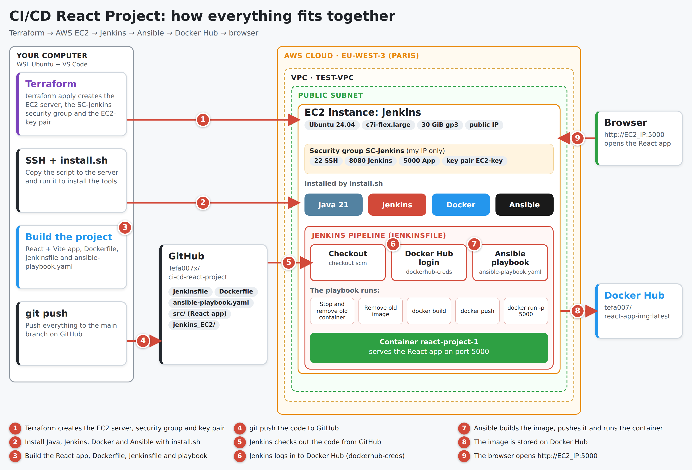

# CI/CD React Project

A complete DevOps practice project: a React + Vite web app that is built, packaged and deployed automatically by a **Jenkins** pipeline running on an **AWS EC2** server that is itself created with **Terraform**.

Every push to `main` can trigger the same flow: checkout, Docker Hub login, then an **Ansible** playbook builds the Docker image, pushes it to Docker Hub and runs the container.

---

## Table of Contents

1. [Architecture](#architecture)
2. [Tech stack](#tech-stack)
3. [Repository structure](#repository-structure)
4. [Prerequisites](#prerequisites)
5. [Step 1: Create the EC2 server with Terraform](#step-1-create-the-ec2-server-with-terraform)
6. [Step 2: Install Jenkins, Docker and Ansible](#step-2-install-jenkins-docker-and-ansible)
7. [Step 3: The React application](#step-3-the-react-application)
8. [Step 4: The Dockerfile](#step-4-the-dockerfile)
9. [Step 5: The Ansible playbook](#step-5-the-ansible-playbook)
10. [Step 6: Configure Jenkins and the pipeline](#step-6-configure-jenkins-and-the-pipeline)
11. [Open the application](#open-the-application)
12. [Security notes](#security-notes)
13. [Troubleshooting](#troubleshooting)
14. [Clean up](#clean-up)
15. [Ideas for next steps](#ideas-for-next-steps)

---

## Architecture



| Component | Role |
|---|---|
| **Terraform** | Creates the EC2 instance, security group and SSH key pair |
| **install.sh** | Installs Java, Jenkins, Docker and Ansible on the server |
| **Jenkins** | Runs the pipeline defined in the `Jenkinsfile` |
| **Ansible** | Builds, pushes and runs the Docker container |
| **Docker / Docker Hub** | Packages the app and stores the image |

## Tech stack

- **App:** React 18, Vite 3, Vitest + Testing Library
- **Containers:** Docker (multi-stage build), Docker Hub
- **CI/CD:** Jenkins (declarative pipeline), Ansible
- **Infrastructure:** Terraform, AWS EC2 (Ubuntu 24.04), existing VPC with a public subnet

## Repository structure

```
.
├── Dockerfile                  # Multi-stage build: build with Node, serve with "serve"
├── Jenkinsfile                 # Pipeline: checkout, Docker Hub login, run Ansible
├── ansible-playbook.yaml       # Builds, pushes and runs the container
├── jenkins_EC2/
│   ├── install.sh              # Installs Java, Jenkins, Docker, Ansible on Ubuntu 24.04
│   └── terraform_jenkins_ec2/
│       ├── provider.tf         # AWS provider (region and CLI profile)
│       ├── variables.tf        # Inputs: region, VPC, subnet, AMI, instance type, my IP
│       ├── main.tf             # The EC2 instance
│       ├── security.tf         # Security group and key pair
│       └── outputs.tf          # Public IP and ready-made SSH command
├── src/                        # React source code
├── public/                     # Static assets (favicon)
├── index.html
├── vite.config.js
├── package.json
├── package-lock.json
└── .gitignore
```

## Prerequisites

On your own computer (Linux, macOS or WSL):

- [Terraform](https://developer.hashicorp.com/terraform/install) 1.3 or newer
- [AWS CLI](https://docs.aws.amazon.com/cli/latest/userguide/getting-started-install.html) with credentials for your AWS account
- Git
- [Node.js](https://nodejs.org/en/download) 20.19 or newer (only to run the app locally)

You also need:

- An AWS VPC with at least one **public subnet** (a route to an Internet Gateway)
- A [Docker Hub](https://hub.docker.com) account
- Your public IP address (run `curl ifconfig.me`)

---

## Step 1: Create the EC2 server with Terraform

The Terraform code lives in `jenkins_EC2/terraform_jenkins_ec2/` and creates:

| Resource | Details |
|---|---|
| EC2 instance | Name `jenkins`, Ubuntu Server 24.04 LTS, `c7i-flex.large`, public IP enabled |
| Storage | 30 GiB `gp3` root volume |
| Network | Existing VPC (`test-VPC`) and a public subnet |
| Security group | `SC-Jenkins`: SSH (22), Jenkins (8080) and React App (5000) access only from your IP |
| Key pair | `EC2-key`, generated by Terraform; the private key is saved as `EC2-key.pem` |

> I didn't create a VPC in Terraform configuration because I already have one.

### 1. Configure the AWS profile

`provider.tf` uses an AWS CLI profile named `terraform`:

```bash
aws configure --profile terraform
```

### 2. Provide your values

Two variables have no default. Create `jenkins_EC2/terraform_jenkins_ec2/terraform.tfvars`:

```hcl
public_subnet_id = "subnet-xxxxxxxxxxxxxxxxx"   # a PUBLIC subnet of your VPC
my_ip_cidr       = "203.xx.xx.xx/32"            # your public IP followed by /32
```

The defaults in `variables.tf` are the region `eu-west-3` (Paris), the VPC ID, the AMI and the instance type. Change them there if your setup is different. The AMI must exist in the region you choose, because AMI IDs are region-specific.

### 3. Deploy

```bash
cd jenkins_EC2/terraform_jenkins_ec2
terraform init
terraform plan
terraform apply
```

Terraform prints the `public_ip` and an `ssh_command`, and creates `EC2-key.pem` in the same folder.

> While applying Terraform will ask for your VPC public subnet ID `public_subnet_id` and your device's public IP `my_ip_cidr`

### 4. Connect to the server

```bash
ssh -i EC2-key.pem ubuntu@<public_ip>
```

`ubuntu` is the default user of Ubuntu AMIs. If SSH complains that the key is too open, run `chmod 400 EC2-key.pem`.

> **Note:** without an Elastic IP, the public IP changes every time the instance is stopped and started. Rebooting keeps it.

---

## Step 2: Install Jenkins, Docker and Ansible

`jenkins_EC2/install.sh` installs everything on the server in order:

| # | Tool | Notes |
|---|---|---|
| 1 | Base packages | `curl`, `gnupg`, `ca-certificates` and others |
| 2 | **Java** | OpenJDK 21. It is installed before Jenkins on purpose, because Jenkins will not start without it |
| 3 | **Jenkins** | LTS release from the official apt repository |
| 4 | **Docker** | Docker Engine, Buildx and Compose plugin from Docker's official repository |
| 5 | **Ansible** | From the official Ansible PPA |
| 6 | Docker group | Adds the `ubuntu` and `jenkins` users to the `docker` group, then restarts Jenkins |

Copy the script to the server (run on your device from `jenkins_EC2/terraform_jenkins_ec2/`), then run it there:

```bash
scp -i EC2-key.pem react-project/jenkins_EC2/install.sh ubuntu@<public_ip>:~ (Copying script from your device to EC2 instance) 
```
From EC2 instance: 

```bash
chmod +x install.sh
./install.sh
```

When it finishes, log out and back in (or run `newgrp docker`) and check:

```bash
docker run hello-world
java -version
ansible --version
systemctl is-active jenkins
```

---

## Step 3: The React application

A small learning hub for Jenkins:

- A **learning path** with five lessons, a progress bar and a copyable sample Jenkinsfile (progress is saved in the browser)
- **Help cards** explaining Jenkins, pipelines and the Jenkinsfile
- A **pipeline strip** (Checkout, Build, Test, Deploy)
- A dark/light **theme toggle**

Run it locally:

```bash
npm ci
npm run dev      # http://localhost:5173
npm run build    # production build in dist/
```

---

## Step 4: The Dockerfile

The image is built in **two stages**:

1. **builder:** `node:22-alpine` installs the dependencies with `npm ci` and runs `npm run build`, which produces the static site in `dist/`.
2. **runtime:** a clean `node:22-alpine` installs [`serve`](https://www.npmjs.com/package/serve), copies in only the `dist/` folder and starts the server on port **5000** as the non-root `node` user.

The final image does not contain the source code, `node_modules` or build tools, so it is smaller and exposes less.

```bash
docker build -t react-app .
docker run -d -p 5000:5000 react-app
```

---

## Step 5: The Ansible playbook

`ansible-playbook.yaml` runs on the Jenkins server itself (`hosts: localhost`, `connection: local`) and performs these tasks:

| # | Task | Command |
|---|---|---|
| 1 | Stop the running container | `docker stop react-project-1` |
| 2 | Remove the stopped container | `docker rm react-project-1` |
| 3 | Remove the old image | `docker rmi tefa007/react-app-img:latest` |
| 4 | Build the image | `docker build -t tefa007/react-app-img:latest .` |
| 5 | Push it to Docker Hub | `docker push tefa007/react-app-img:latest` |
| 6 | Run the new container | `docker run -d --name react-project-1 -p 5000:5000 tefa007/react-app-img:latest` |

Tasks 1 to 3 use `ignore_errors: yes`, so the very first run (when nothing exists yet) does not fail.

Run it by hand to test:

```bash
ansible-playbook ansible-playbook.yaml
```

---

## Step 6: Configure Jenkins and the pipeline

### 1. Unlock Jenkins

Open `http://<public_ip>:8080`. Get the initial admin password on the server:

```bash
sudo cat /var/lib/jenkins/secrets/initialAdminPassword
```

Install the suggested plugins and create your admin user.

### 2. Add the Docker Hub credential

1. In Docker Hub, create an access token: **Account settings, Personal access tokens, Generate new token** (Read & Write).
2. In Jenkins: **Manage Jenkins, Credentials, System, Global credentials, Add Credentials**.
3. Kind: **Username with password**
4. Username: your Docker Hub username
5. Password: the **access token** (not your account password)
6. ID: `dockerhub-creds` (the `Jenkinsfile` refers to this exact ID)

### 3. Create the pipeline job

1. **New Item**, choose **Pipeline** and name it.
2. Under **Pipeline**, set **Definition** to *Pipeline script from SCM*.
3. SCM: **Git**, Repository URL: `https://github.com/Tefa007x/ci-cd-react-project.git`
4. Branch Specifier: `*/main`
5. Script Path: `Jenkinsfile`
6. Save, then click **Build Now**.

To start builds automatically, enable **Poll SCM** under *Build Triggers* (for example `* * * * *` triggers every minute). A GitHub webhook would not reach this Jenkins, because the security group only allows port 8080 from your own IP.

### 4. What the pipeline does

| Stage | What happens |
|---|---|
| **Checkout** | `checkout scm` pulls the repository and branch configured in the job |
| **Docker Hub Login** | Reads `dockerhub-creds` and runs `docker login --password-stdin`, so the secret never appears in the log |
| **Run Ansible Playbook** | Prints the Ansible version, then runs `ansible-playbook ansible-playbook.yaml` |
| **Post actions** | Always runs `docker logout`, so the saved login is removed from the server |

---

## Open the application

After a successful build, open:

```
http://<public_ip>:5000
```

You can also check the container on the server:

```bash
docker ps
docker logs react-project-1
```

The image is published on Docker Hub, so (if the repository is public) you can run it anywhere:

```bash
docker run -d -p 5000:5000 tefa007/react-app-img:latest
```

---

## Security notes

- The security group allows SSH (22), Jenkins (8080) and the app (5000) **only from your IP** (`my_ip_cidr`). If your IP changes, update the variable and run `terraform apply` again.
- **Never commit** `EC2-key.pem`, `*.tfstate` or `*.tfvars`. The Terraform state file also contains the private key. These files are listed in `.gitignore`.
- Use a Docker Hub **access token**, stored in the Jenkins credentials store. Never put it in the `Jenkinsfile`.
- The container runs as the non-root `node` user.
- Jenkins runs Docker commands through the `docker` group, which is effectively root-level access on that server. Keep Jenkins private and protected.

## Troubleshooting

Problems that I faced while building this project:

| Problem | Cause | Fix |
|---|---|---|
| `InvalidAMIID.NotFound` during `terraform apply` | The AMI does not exist in the chosen region | Use an AMI ID from the same region as `aws_region` |
| Instance type is rejected | `c7i-flex-large` is not a valid name | Use `c7i-flex.large` |
| SSH: `Permission denied (publickey)` | Wrong key file, wrong user or the key is not found | Use `-i EC2-key.pem` with the user `ubuntu`, from the folder that contains the key |
| `create-vite` fails with `styleText` not exported | Node.js 18 is too old for current Vite tooling | Install Node.js LTS (Latest Version) |
| Docker build: `Could not resolve './assets/...png'` | Image path or file name does not match (Linux is case-sensitive) or `.dockerignore` excludes it | Make the import path match the real file |
| `docker login`: `must log in with a Personal Access Token` | Docker Hub rejects account passwords for CLI login | Store an access token in the `dockerhub-creds` credential |
| `ansible-playbook: error: the following arguments are required: playbook` | The playbook was passed after `-i` and was read as an inventory | Run `ansible-playbook ansible-playbook.yaml` |
| Jenkins: `permission denied` on the Docker socket | The `jenkins` user is not in the `docker` group yet | `sudo usermod -aG docker jenkins` and `sudo systemctl restart jenkins` |
| App not reachable in the browser | Port 5000 is not open in the security group, or the public IP changed | Add the port 5000 rule or check your current IP in the EC2 console |

## Clean up

To avoid AWS charges, remove everything Terraform created:

```bash
cd jenkins_EC2/terraform_jenkins_ec2
terraform destroy
```

Stopping the instance keeps your data (the 30 GiB volume), but terminating it or running `terraform destroy` deletes it permanently.

## Ideas for next steps

- Tag images with the build number (`${BUILD_NUMBER}`) instead of only `latest`
- Attach an Elastic IP so the public IP never changes
- Put the app behind Nginx with HTTPS
- Deploy to Kubernetes instead of a single Docker container
